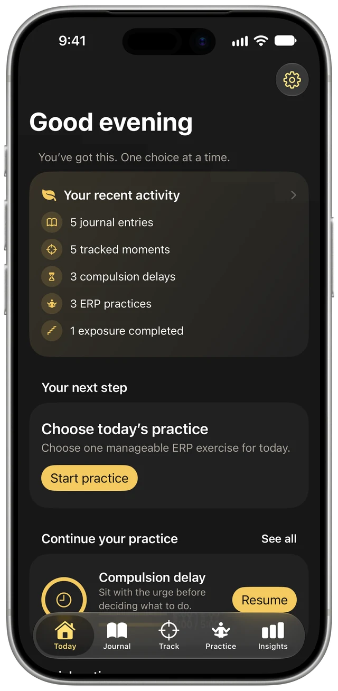
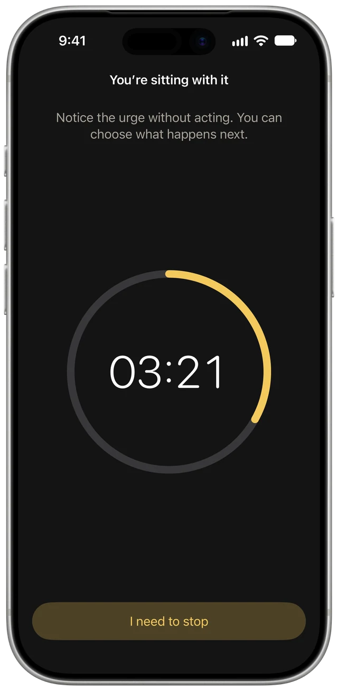
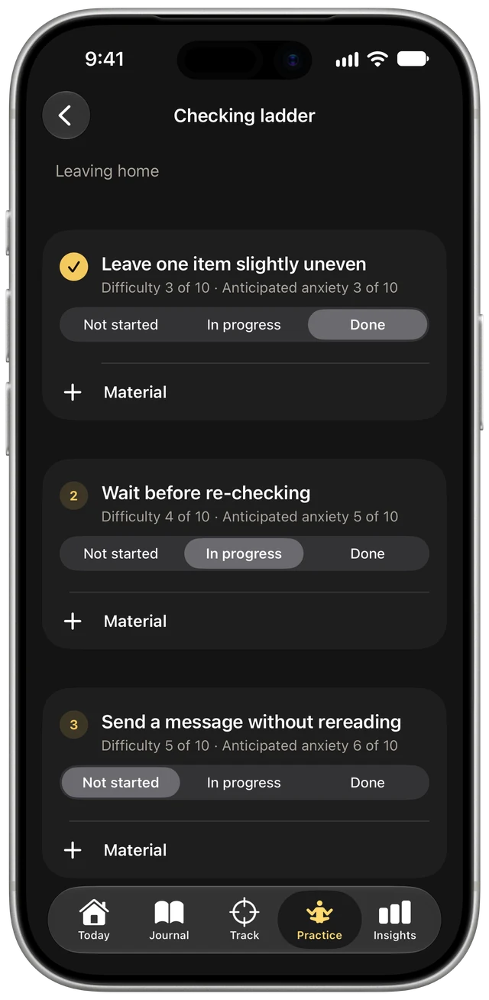
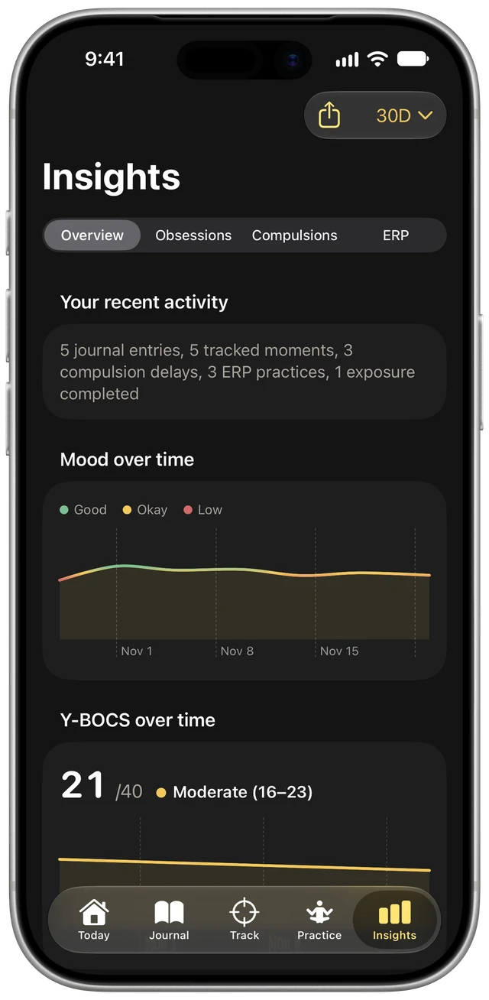

  

<h1 align="center">Patterns</h1>

  <strong>A private OCD journal and ERP companion for iPhone and Android.</strong> 
  See the loop. Choose your next response.

  
  
  
  

Patterns helps you notice what happens between an intrusive thought and a compulsion, and practise doing something different. Write, log what OCD is asking of you, delay an urge, and work through exposures at your own pace. Everything stays on your phone. There is no account to create and nobody else reads your notes.

  
  
  
  

## Why Patterns exists

I live with OCD. For years I could describe my intrusive thoughts in exhausting detail but could not see the pattern around them: the reassurance seeking, the checking, the avoidance. Learning to recognise that loop is what made ERP start to work for me, and most of that work happens between therapy sessions, alone, on an ordinary day.

Patterns is the tool I wanted for those days. It is open source because an app that holds something this personal should be one you can check for yourself.

## Features

### Free, with no time limit

- **Journal:** a dated writing space with rich text and prompts for the days a blank page is too much.
- **OCD log:** record obsessions and compulsions as they happen, with distress rated 0 to 10 on the SUDS scale used in ERP.
- **Y-BOCS self-check:** track symptom severity over time with the standard Yale-Brown scale.
- **Guided ERP:** exposure and response prevention exercises to practise at your pace.
- **Compulsion delay:** put a timed pause between the urge and the action and watch the urge rise and fall.
- **Emergency toolkit and coping library:** grounding techniques and reframes, one tap away when distress spikes.
- **Insights:** how often you practise, how urges move, and how consistent the week was.
- **PDF report:** a clear summary you can bring to a therapist.

### Patterns Pro, a one-time unlock

- **Exposure hierarchy and materials:** build a ladder from easiest to hardest and keep the scripts, images and notes you use for each step.
- **Response prevention:** plan and log how you held back from a compulsion.
- **Structured programs:** multi-day plans that sequence exposures for you.
- **Urge surfing and uncertainty training:** short practices for riding out an urge and tolerating doubt.
- **Behavioural experiments, action planner and implementation intentions:** test the anxious forecast and decide in advance what you will do.
- **Recovery metrics and reflection journal:** see the longer story and learn from each exposure.

Pro is $19.99 in the US (prices vary by country). It is one payment, never a subscription.

### Everywhere

- **Private by design:** app lock with biometrics or the device passcode, plus export, backup and full data deletion.
- **Six languages:** English, German, Spanish, French, Japanese and Brazilian Portuguese.
- **Light and dark themes,** with screen reader labels and larger text support.

## Privacy you can verify

Journal entries, OCD events, ratings, practice logs and everything else you enter stay on your device. Patterns has no account, no cloud sync, no ads and no third-party analytics SDK.

There is one optional, off-by-default setting that shares a small, fixed set of anonymous feature-use events. It never includes anything you write or rate. You do not have to take our word for it:

| What | Where to look |
| --- | --- |
| On-device database (Android) | [`lib/database`](lib/database) |
| On-device database (iPhone) | [`apple/Packages/PatternsCore`](apple/Packages/PatternsCore) |
| Every analytics event that can ever be sent | [`backend/analytics/src/events.ts`](backend/analytics/src/events.ts) |
| How the app decides whether to send them | [`lib/services/usage_analytics.dart`](lib/services/usage_analytics.dart) |

Manual exports are plain JSON or PDF files saved wherever you choose, so keep them somewhere private. The full policy is at [patternsocd.com/privacy](https://patternsocd.com/privacy).

## Help Patterns grow

Patterns is built by one person. Every bit of help reaches more people who are trying to get through OCD on their own.

- **Tell someone.** A star on this repo, a rating on the [App Store](https://apps.apple.com/us/app/patterns-ocd-journaling/id6762611172) or [Google Play](https://play.google.com/store/apps/details?id=com.maskedsyntax.patterns), or a mention to your therapist or support group helps people find it.
- **Share what works and what does not.** Ideas and questions go in [Discussions](https://github.com/gentleloop-labs/patterns/discussions). Bugs go in [Issues](https://github.com/gentleloop-labs/patterns/issues).
- **Improve a translation.** All app text for both iPhone and Android lives in [`lib/l10n`](lib/l10n) as `.arb` files. Native speakers who can make the wording warmer or more natural are especially welcome, and so are new languages.
- **Contribute code.** Pick up an issue, or open a discussion first for anything large. See [CONTRIBUTING.md](CONTRIBUTING.md).
- **Support the work.** Buying Pro, [GitHub Sponsors](https://github.com/sponsors/maskedsyntax) and [Ko-fi](https://ko-fi.com/aftaabsiddiqui) keep Patterns independent and free of ads.

## Building from source

| Path | What it is | Get started |
| --- | --- | --- |
| [`apple`](apple) | The native iPhone app, written in SwiftUI | `open apple/Patterns.xcodeproj` (regenerate with `xcodegen generate` after editing `project.yml`) |
| [`lib`](lib), [`android`](android) | The Android app, built with Flutter | `flutter pub get && flutter run` |
| [`website`](website) | [patternsocd.com](https://patternsocd.com/), built with SvelteKit | `cd website && npm install && npm run dev` |
| [`backend`](backend) | The optional analytics endpoint and Google Play purchase handler | See each folder's README |

Run `flutter test` for the shared app tests. The iPhone app reads the same on-device data format as the Flutter app, and [`apple/README.md`](apple/README.md) explains how that compatibility is tested.

## A note on care

Patterns is for personal reflection and self-tracking. It does not diagnose, treat or cure any condition and is not a replacement for a qualified clinician. If you are in crisis, please contact local emergency services or a crisis line.

Please be kind in issues and discussions. People open this app on hard days.

## License

[MIT](LICENSE) © Aftaab Siddiqui
